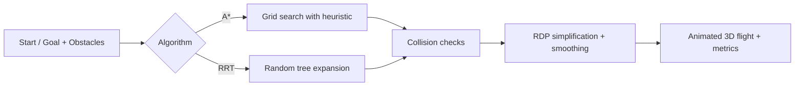

<div align="center">

# 🚁 3D Drone Path Planning with Obstacle Avoidance

**An interactive 3D simulator that compares A\* and RRT pathfinding for a drone flying through obstacles.**

[](https://3-d-drone-path-planning-with-obstac.vercel.app/)


</div>

---

## ✨ Features

- **Two planning algorithms**
  - **A\***: grid-based search in 3D with a heuristic-guided open set.
  - **RRT** (Rapidly-exploring Random Tree): sampling-based search with a 10% goal bias. It works well in large or cluttered spaces.
- **Obstacle environment**: add and remove **box** and **sphere** obstacles. Collisions are checked against a configurable drone radius.
- **Configurable start and goal**: set X/Y/Z coordinates for both endpoints from the control panel.
- **Path post-processing**: Ramer–Douglas–Peucker simplification, path smoothing, and smooth curve interpolation, so the drone follows realistic trajectories.
- **Animated drone and trail**: the drone flies the computed path in a live 3D scene and leaves a trail behind it.
- **Performance metrics**: path length, computation time, nodes explored, collision-avoidance rate, and waypoint count.
- **Side-by-side comparison**: run both algorithms on the same environment and compare their metrics.

## 🧠 How It Works



| | A\* | RRT |
|---|---|---|
| Type | Graph search (grid) | Sampling-based |
| Optimality | Optimal on the grid | Not optimal; finds a feasible path quickly |
| Best for | Structured, bounded spaces | High-dimensional or cluttered spaces |

## 📁 Project Structure

```
src/
├── components/
│   ├── Scene3D.tsx           # Three.js scene: obstacles, path, explored nodes
│   ├── AnimatedDrone.tsx     # Drone model + flight animation
│   ├── ControlPanel.tsx      # Algorithm, start/goal and obstacle controls
│   ├── MetricsPanel.tsx      # Per-run performance metrics
│   └── ComparisonMetrics.tsx # A* vs RRT comparison
├── utils/
│   └── pathfinding.ts        # A*, RRT, collision checks, RDP, smoothing
└── pages/
    └── Index.tsx             # Main simulator page
```

## 🚀 Getting Started

```sh
git clone https://github.com/parvatkhattak/3D-Drone-Path-Planning-with-Obstacle-Avoidance.git
cd 3D-Drone-Path-Planning-with-Obstacle-Avoidance
npm install
npm run dev
```

Then open http://localhost:8080.

## 🛠️ Tech Stack

React · TypeScript · Three.js · @react-three/fiber · @react-three/drei · Vite · Tailwind CSS · shadcn/ui

---

<div align="center">
Built by <a href="https://github.com/parvatkhattak">Parvat Khattak</a>
</div>
